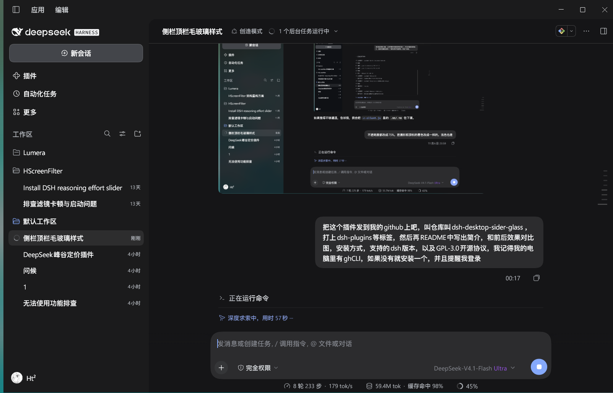
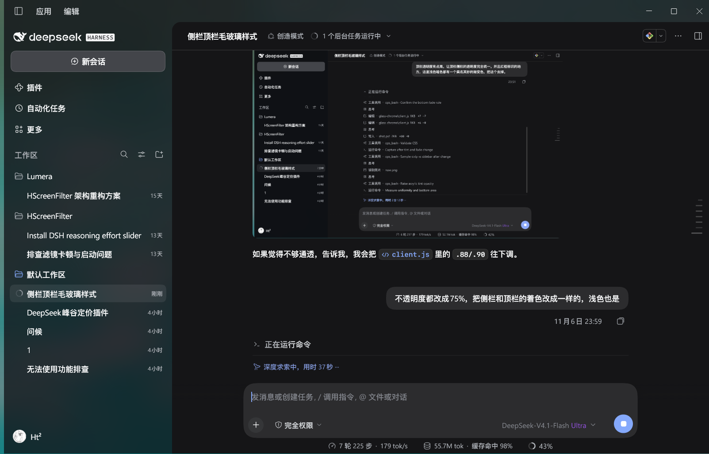

# dsh-desktop-sider-glass

给 **DeepSeek Harness** 桌面端做的毛玻璃皮肤：侧栏和顶部标题栏共用同一层着色，透明度、色值完全一致，深色 / 浅色各一套。


## 效果对比

| 之前 | 之后 |
| --- | --- |
|  |  |

- 之前：侧栏和标题栏是两块不透明的纯色，与内容区同色。
- 之后：侧栏 + 标题栏是一整块玻璃，能透过它看到窗口后面的桌面（Windows 11 acrylic），右上角窗口按钮区域也不再出现二次叠色。

## 特性

- **同一层着色**：顶栏（frame 的顶部内边距）和侧栏（透明列）共用同一个 `--glass-fill`，接缝处像素一致。
- **桌面采样**：窗口透明 + 系统 acrylic，玻璃后面是真实桌面，不是页面内伪造的背景。
- **深色 / 浅色统一**：两套主题都是 75% 不透明度，浅色 `rgba(250, 251, 253, .75)`，深色 `rgba(14, 15, 20, .75)`。
- **去掉杂色**：关掉了会话列表底部 24px 的淡出渐变（它原来用不透明的侧栏填充色绘制，玻璃化之后会变成一条怪渐变）。
- **只依赖 4 个 CSS 变量**：`--glass-fill`、`--glass-line`、`--glass-glow-a`、`--glass-glow-b`。

## 安装

本仓库是一个 DSH **bundle**（`package.json` 里的 `dsh.bundle` + `dsh.client`）。

1. 克隆仓库到本地：

   ```bash
   git clone https://github.com/Htonng/dsh-desktop-sider-glass.git
   ```

2. 在 DSH Desktop 里：**设置 → 插件**，用插件管理器的“安装本地 bundle / 本地目录”入口选择本仓库目录。
   安装后插件会出现在插件列表里，启用即可（新装 bundle 会热更新，无需重启）。

3. 如果手动接入 profile：把仓库目录 link 进 profile 的 `node_modules`，并把包名 `dsh-desktop-sider-glass` 加入 profile `package.json` 的 `dsh.profile.bundles`。

> 顶栏相关的选择器依赖 Windows 标题栏模式（`html[data-windows-titlebar]`）与布局包的 `_frame` / `_sidebarCol` 类名后缀；其它平台上侧栏玻璃仍然生效，顶栏部分自动跳过。

## 支持的 DSH 版本

- 实测：**DSH Desktop 0.2.2-rc.1**（Electron 44.7.0，Windows 11 build 26300）。
- 需要 DSH 的 Client 插件接口（`dsh.client`）以及布局包的类名后缀（`_frame`、`_sidebarCol`）。升级 DSH 后如果类名后缀变化，需要同步修改 `client.js` 里的选择器。
- Web 版可用：没有桌面壳补丁时自动回退到内置的环境光背景玻璃，不采样桌面。

## 桌面采样（可选，需要改桌面壳）

页面里的 `backdrop-filter` 只能模糊窗口内部已经绘制的内容，桌面在窗口合成面之下。要让玻璃真正采样桌面，需要桌面壳在创建主窗口时使用透明背景 + 系统 acrylic：

```js
// resources/app.asar 内 lib/main.js 的 createWindow，win32 && primary 分支
backgroundColor: "#00000000",
backgroundMaterial: "acrylic",
```

并在页面加载完成后打一个标记，插件据此切换到 acrylic 分支：

```js
window.webContents.on("did-finish-load", () => {
  window.webContents.executeJavaScript("document.documentElement.dataset.windowMaterial='acrylic'");
});
```

没有这个补丁时插件会停在默认的环境光玻璃分支，功能正常，只是不透明桌面。
改壳有风险（升级会被覆盖），请先备份 `app.asar`。

## 调整

`client.js` 顶部：

```css
--glass-fill: rgba(14, 15, 20, .75);   /* 深色：调整颜色与透明度 */
--glass-fill: rgba(250, 251, 253, .75); /* 浅色 */
```

保存后热更新生效。

## 协议

[GPL-3.0](LICENSE)
