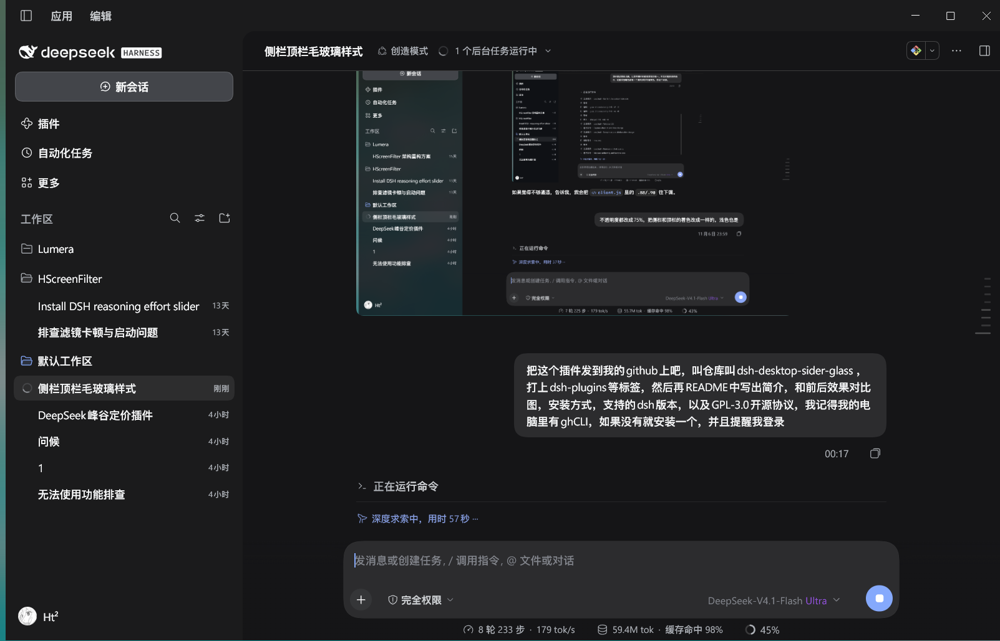
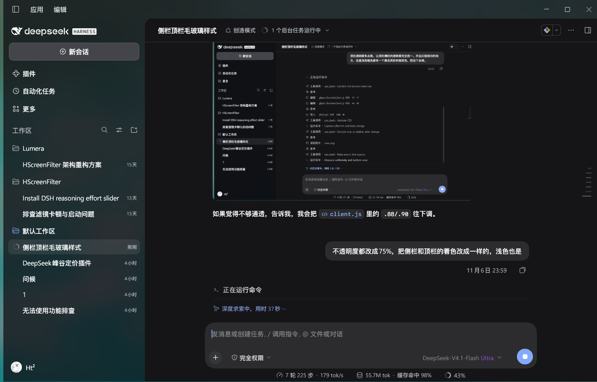

<div align="center">


<h1>dsh-desktop-sider-glass</h1>

<p>DeepSeek Harness 桌面端的毛玻璃皮肤<br />侧栏与顶部标题栏共用同一层玻璃：透明度一致、深浅色统一</p>

<p>
  <a href="LICENSE"></a>
  <a href="https://github.com/topics/dsh-plugins"></a>
  <a href="https://github.com/topics/dsh-plugins"></a>
  
  <a href="https://github.com/Htonng/dsh-desktop-sider-glass/stargazers"></a>
</p>

<p>
  <a href="#让-agent-帮你安装">安装提示词</a> ·
  <a href="#效果对比">效果对比</a> ·
  <a href="#安装">安装</a> ·
  <a href="#支持的-dsh-版本">支持版本</a> ·
  <a href="LICENSE">开源协议</a>
</p>

</div>

---

## 让 Agent 帮你安装

把下面这段直接发给你的 DSH Agent，让它替你装好并验证：

```text
请把 https://github.com/Htonng/dsh-desktop-sider-glass 安装到当前 DSH profile：
1. clone 到当前工作区；
2. 作为 bundle 安装（plugin_manager 的 install_bundle，target 指向 clone 出来的目录）；
3. 确认插件行已启用，然后截图确认侧栏和顶栏都变成毛玻璃，深色 / 浅色都正常。
```

## 效果对比

| 之前 | 之后 |
| :---: | :---: |
|  |  |

- **之前**：侧栏和标题栏是两块不透明的纯色，与内容区同色。
- **之后**：侧栏 + 标题栏是一整块玻璃，能透过它看到窗口后面的桌面（Windows 11 acrylic）；右上角窗口按钮区域也不再出现二次叠色。

## 特性

- **同一层着色**：顶栏（frame 的顶部内边距）和侧栏（透明列）共用同一个 `--glass-fill`，接缝处像素一致。
- **桌面采样**：窗口透明 + 系统 acrylic，玻璃后面是真实桌面，不是页面内伪造的背景。
- **深色 / 浅色统一**：两套主题都是 75% 不透明度，浅色 `rgba(250, 251, 253, .75)`，深色 `rgba(14, 15, 20, .75)`。
- **去掉杂色**：关掉了会话列表底部 24px 的淡出渐变（它原来用不透明的侧栏填充色绘制，玻璃化之后会变成一条怪渐变）。
- **只依赖 4 个 CSS 变量**：`--glass-fill`、`--glass-line`、`--glass-glow-a`、`--glass-glow-b`。

## 安装

本仓库是一个 DSH **bundle**（`package.json` 里的 `dsh.bundle` + `dsh.client`）。

1. 克隆仓库到本地：

   ```bash
   git clone https://github.com/Htonng/dsh-desktop-sider-glass.git
   ```

2. 在 DSH Desktop 里：**设置 → 插件**，用插件管理器的“安装本地 bundle / 本地目录”入口选择本仓库目录。
   安装后插件会出现在插件列表里，启用即可（新装 bundle 会热更新，无需重启）。

3. 如果手动接入 profile：把仓库目录 link 进 profile 的 `node_modules`，并把包名 `dsh-desktop-sider-glass` 加入 profile `package.json` 的 `dsh.profile.bundles`。

> 顶栏相关的选择器依赖 Windows 标题栏模式（`html[data-windows-titlebar]`）与布局包的 `_frame` / `_sidebarCol` 类名后缀；其它平台上侧栏玻璃仍然生效，顶栏部分自动跳过。

## 支持的 DSH 版本

- 实测：**DSH Desktop 0.2.2-rc.5**（Electron 44.7.0）；0.2.2-rc.1 同样可用。
- 需要 DSH 的 Client 插件接口（`dsh.client`）以及布局包的类名后缀（`_frame`、`_sidebarCol`）。升级 DSH 后如果类名后缀变化，需要同步修改 `client.js` 里的选择器。
- Web 版可用：没有桌面壳补丁时自动回退到内置的环境光背景玻璃，不采样桌面。

## 桌面采样（可选，需要改桌面壳）

页面里的 `backdrop-filter` 只能模糊窗口内部已经绘制的内容，桌面在窗口合成面之下。要让玻璃真正采样桌面，需要桌面壳把主窗口设为透明 + 系统 acrylic。仓库里带了脚本：

```bash
# 先完全退出 DeepSeek Harness
node shell/patch-asar.mjs "D:\deepseek-harness"
# 然后重新启动应用
```

还原：

```bash
node shell/patch-asar.mjs "D:\deepseek-harness" --restore
```

脚本会先把 `resources/app.asar` 备份成 `app.asar.bak`，再用**同长度原位写入**改两个文件，重复执行会提示 `already patched`；遇到不认识的版本会直接报错而不是乱改。

它具体改了什么（Windows）：

- `lib/main.js` · `createWindow()`：`backgroundColor: "#00000000"` + `backgroundMaterial: "acrylic"`
- `lib/main.js` · `enterWorkspace()`：导航完成后的 `setBackgroundColor(chromeFallbackFill())` 改成 `#00000000`（0.2.2-rc.5 新加的，不改会把透明覆盖回去）
- `lib/main.js` · `updateBackground()`：主题切换回调同样保持 `#00000000`
- `lib/preload-app.cjs` · `syncWindowsAppearance().mark()`：写入 `data-window-material="acrylic"`，插件据此切到 acrylic 分支

没有这个补丁时插件会停在默认的环境光玻璃分支，功能正常，只是不透明桌面。

> 改壳有风险，且每次应用更新都会覆盖回去，需要重新执行一次脚本。

## 调整

`client.js` 顶部：

```css
--glass-fill: rgba(14, 15, 20, .75);    /* 深色：调整颜色与透明度 */
--glass-fill: rgba(250, 251, 253, .75); /* 浅色 */
```

保存后热更新生效。

## 开源协议

[GPL-3.0](LICENSE)
